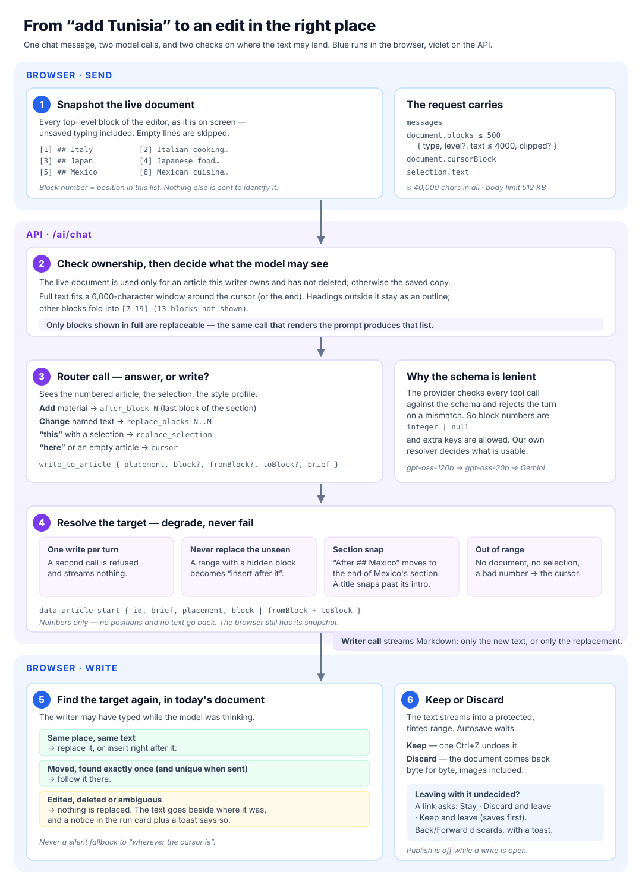

# How the editor assistant writes into an article



## What it is for

The writer types a request in the assistant panel, such as "add Tunisia",
"rewrite the Japan section" or "make this punchier", and the text appears in
the article, **in the right place**, waiting for Keep or Discard.

"The right place" is the whole difficulty. Until 2026-10-22 the assistant had
only two ways to write: at the cursor, or over a selection. It saw the article
as one run of plain text, with headings and paragraph breaks removed. Asked to
"add Tunisia" to an article with sections on Italy, Japan and Mexico, it had
nothing to point at. It wrote the whole article out again with Tunisia added,
and that copy landed under the original.

The pipeline below exists so that a request can name **which part** of the
article it is about. The browser then checks that part is still there before
anything is replaced.

---

## The walk-through

The example throughout is the one that exposed the problem:

```
[1] ## Italy      [2] Italian cooking rests on a few good ingredients…
[3] ## Japan      [4] Japanese food values freshness and balance…
[5] ## Mexico     [6] Mexican cuisine is built on corn, beans and chilies…
```

### 1 · The browser snapshots the live document

When the writer presses Send, `snapshotDocument()` in
`frontend/src/features/ai/document-blocks.ts` walks the editor's top-level
nodes and builds two lists from the same pass:

- **The wire list**, which goes in the request. It has one entry per block, and
  every entry has exactly the four keys the API declares:
  `{ type, level?, text, clipped? }`. A list, quote or code block is a single
  block, with its items as lines.
- **The snapshot**, which stays in the browser. It holds the same blocks, plus
  each block's full text and its position among the live document's children,
  to be used later for verification.

Empty paragraphs are skipped, so they never take a number. A block's number is
its position in the wire list, counting from 1. No id is sent, so the browser
and the server can never number the blocks differently.

The request also carries `cursorBlock`, the block holding the cursor, and the
selected text when there is a selection. When the cursor was never placed (a
freshly opened editor has it at the very start), no `cursorBlock` is sent.

The text is the editor's **live** content, unsaved keystrokes included. Before
this change the server read the last autosaved copy, so whatever was typed in
the last 1.5 seconds, or while a write was open, was invisible to the model.

| Limit | Value | When exceeded |
|---|---|---|
| Blocks | 500 | no `document` is sent; the server uses the saved copy |
| Characters per block | 4,000 | clipped and marked `clipped`; never replaceable |
| Characters in all | 40,000 | body text is dropped first; headings keep 200 each |
| Request body | 512 KB | raised from Nest's 100 KB default in `main.ts` |

### 2 · The API checks ownership, then decides what the model may see

The live document is used **only** when `articleId` belongs to the signed-in
writer and is not deleted. It is the same query that has always gated the
saved copy. If the cross-field checks fail (over 40,000 characters, or a
`cursorBlock` past the end), the document is ignored with a warning and the
saved copy is used. That is a fallback, never a 400.

`renderArticle()` (`backend/src/ai/prompts/article-blocks.prompt.ts` and
`chat.prompt.ts`) turns the blocks into numbered prompt lines:

```
The writer's article, as numbered blocks. [n] is the block's number.
[1] ## Italy
[2] Italian cooking rests on a few good ingredients…
…
[7–19] (13 blocks not shown)
```

A long article does not fit, so it is **windowed**:

- Up to 6,000 characters of full text are shown around `cursorBlock`, or around
  the last block when there is none, because "add X" usually goes at the end.
- Headings outside the window are still listed, as an outline of up to 1,500
  characters.
- Every other hidden run collapses into one `[a–b]` line.

The same call returns a `replaceable(n)` predicate: a block is replaceable
when its full text was in the prompt and it was not clipped. The prompt and
the rule about what may be replaced come from **one** function call, so they
cannot disagree.

### 3 · The router call: answer in chat, or write?

The first model call (Groq `gpt-oss-120b`, falling back to `gpt-oss-20b` and
then Gemini) sees:

- the routing rules;
- the numbered article;
- **the selected passage**, if there is one;
- the writer's style profile and any attached reference documents.

It either answers in chat, or calls the one tool:

```ts
write_to_article {
  placement: 'cursor' | 'replace_selection' | 'after_block' | 'replace_blocks',
  block?:     integer | null,   // after_block
  fromBlock?: integer | null,   // replace_blocks
  toBlock?:   integer | null,   // replace_blocks
  brief: string,                // one line: what it is about to write
}
```

The routing rules, in short:

| The writer says | The model should choose |
|---|---|
| add a section, a paragraph, an item | `after_block` with the **last** block of the section it follows |
| rewrite / change "the Japan section", "the intro" | `replace_blocks` from its first to its last block, heading included |
| "make **this** punchier" with text selected | `replace_selection` |
| "write here", or the article is empty | `cursor` |

The router is also told: never replace a block that is not shown, and call the
tool at most once per turn.

**Why the selection is in the router prompt.** Only the writing call used to
see the selection. The routing call was told to use `replace_selection` "when
the request is about the selected text" without being told there was any. With
two placements it mostly guessed right. With four, "make this punchier" over
one selected paragraph came back as `replace_blocks` over every paragraph.

**Why the schema is lenient.** The provider validates every tool call against
the JSON schema itself and rejects the whole turn when it does not match. The
writer sees only "Something went wrong". Seen live: `block: null`, and a stray
key named `after_block`. So the provider gets a hand-written schema
(`WRITE_TOOL_JSON_SCHEMA` in `write-placement.ts`) in which block numbers are
`["integer", "null"]`. That is a type list, not `anyOf`, which gpt-oss handles
poorly. It also allows extra keys. `normaliseToolInput()` then turns the call
into the strict shape the resolver expects: `null` becomes "not given", and a
number filed under the placement's own name is recovered.

### 4 · The resolver: degrade, never fail

`resolveWriteTarget()` in `backend/src/ai/write-placement.ts` decides what the
server will actually announce. It is pure, so every rule is under jest.

| Rule | What happens |
|---|---|
| **One write per turn** | A second call is refused with an error the model relays, and nothing is streamed. Previously a second write silently *kept* the first, approving text the writer never saw. |
| **Never replace the unseen** | A `replace_blocks` range containing a hidden or clipped block becomes `after_block(toBlock)`, so the text goes beside its target, never over it. |
| **Section snap** | `after_block` on a heading moves to the end of that heading's section: the block before the next heading of the same or a higher level, else the end of the document. "After `## Mexico`" means after Mexico's paragraph, not between the heading and its body. |
| **Titles** | A first heading that contains every other heading is a title. It snaps only past its own intro, so "add an intro under the title" does not land after the last section. |
| **Out of range** | No document, a missing or impossible number, or `replace_selection` without a selection becomes `cursor`. |

The result goes to the browser as a stream part:

```ts
data-article-start { id, brief, placement: 'after_block', block: 6 }
data-article-start { id, brief, placement: 'replace_blocks', fromBlock: 3, toBlock: 4 }
```

Numbers only: no document positions and no text go back. The browser still
holds its snapshot.

**The writer call** is the second model call. It streams Markdown, and its
prompt depends on the placement:

| Placement | The writer is told |
|---|---|
| `cursor` | Write only the new material. Everything below is already in the document: never repeat it, never return a revised copy. *(This sentence alone stops the original duplication, even for older clients.)* |
| `after_block N` | Insert directly after block N, which is quoted. Write only the new material; a new section opens with a heading at the article's section level. |
| `replace_blocks N..M` | Your entire output replaces blocks N–M, which are quoted verbatim. Write the replacement only, at about the same length, and stop. |
| `replace_selection` | Your entire output replaces the selected passage, which is quoted. |

It is also told never to write block numbers such as `[3]` into the text.

### 5 · The browser finds the target again

The model can take several seconds, and the editor is not locked while it
thinks. `planWrite()` in `document-blocks.ts` therefore checks the target
against the document **as it is now** before writing anything:

1. **Same place, same text.** The live blocks at the snapshot's positions
   still have the same type, level and text. Replace them, or insert right
   after them.
2. **Moved.** Otherwise, look for the same run of blocks somewhere else. It is
   used only if it occurs **exactly once now and occurred exactly once when the
   request was sent**. That covers a paragraph typed above the target. The
   second condition matters for an article that already held the same section
   twice, after the old duplication bug: deleting one copy must not make the
   other copy a target.
3. **Edited, deleted, or ambiguous.** Nothing is replaced:
   - a rewrite is shown **beside** its target;
   - an insert whose target was edited goes just after it, in front of the
     next block, at the end of the document if it was the last block, or after
     the node that follows the previous block;
   - in every case a **notice** in the run card and a toast say what happened.

There is no path where a failed check becomes a silent insert at the cursor.

`replace_selection` keeps its original exact check first, then tries a unique
match of whole blocks, then inserts beside the selection with a notice.

### 6 · The write range, Keep and Discard

The text streams into a protected, tinted range (`ai-write-range.ts`). The
writer cannot type inside it, autosave is suspended while it is open, and the
chat input is disabled until it is decided.

- **Keep** commits it as **one** undo step.
- **Discard** puts the document back byte for byte, including the heading
  level of a replaced section and any image a rewrite took with it. A rewrite
  of the whole article restores the content wholesale, so no stray empty
  paragraph is left behind.

**Leaving with a write still undecided.** A click on any in-app link is
stopped before Next's router sees it (`use-leave-guard.ts`, a capture-phase
listener), and the writer is asked:

| Button | What it does |
|---|---|
| **Stay** (focused) | Closes the question; the write is untouched. |
| **Discard and leave** | Discards, then navigates. |
| **Keep and leave** (drafts) | Keeps, **saves and waits for the save**, then navigates. If the save fails, the writer stays, and autosave is re-armed so the kept text is not lost. |

A published article has no "Keep and leave": nothing autosaves there, so the
dialog says to keep the text and press Update.

The question closes on its own if the write is decided from the Keep/Discard
bar while it is open. Browser Back and Forward cannot be intercepted in this
version of Next. They discard the unkept text and a toast says so. Previously
the text was dropped silently. **Publish** is disabled while a write is open.

---

## Style profile: voice, not subject

The writer's style profile (`prompts/memory.prompt.ts`) and the passages
retrieved from their published work (see [RAG.md](RAG.md)) are there so the
assistant writes **like them**. They were also pulling in **what they usually
write about**. A food article written for a writer who covers surfcasting came
back full of "a tide gauge of flavour" and "the barotrauma of spice".

Now:

- **Usual subjects** are no longer injected; they are stored but not prompted.
- **Recurring vocabulary** may be used only where it belongs to *this*
  article's subject.
- The profile states that it describes **how** they write, not **what**
  about.
- The retrieved passages are a reference for sentence rhythm, register and
  structure. Their subject matter, metaphors and terms of art are not to be
  borrowed.

---

## Where the code is

| Concern | File |
|---|---|
| Request shape and limits | `backend/src/ai/dto/chat.dto.ts` |
| Live document → numbered, windowed prompt | `backend/src/ai/prompts/article-blocks.prompt.ts` |
| Router and writer prompts | `backend/src/ai/prompts/chat.prompt.ts` |
| Style profile wording | `backend/src/ai/prompts/memory.prompt.ts` |
| Tool schema, normaliser, resolver, snap | `backend/src/ai/write-placement.ts` |
| Stream parts | `backend/src/ai/article-write-stream.ts` |
| Orchestration (both model calls) | `backend/src/ai/ai.service.ts` |
| Snapshot, verification, write plan | `frontend/src/features/ai/document-blocks.ts` |
| The write range and Keep/Discard | `frontend/src/features/ai/article-writer.ts`, `features/editor/ai-write-range.ts` |
| Sending, and applying the start part | `frontend/src/features/ai/use-ai-assistant.ts` |
| Leave guard and dialog | `frontend/src/features/editor/use-leave-guard.ts`, `features/ai/ai-leave-dialog.tsx`, `ai-assistant-host.tsx` |

## How it is tested

`ai.service.ts` cannot be loaded by jest, because the `ai` SDK is ESM-only.
Every decision therefore lives in a pure module next to it, and those modules
are fully specced:

- **Backend jest** (`npm test -- src/ai`): rendering and windowing, the
  resolver and its snap and title rules, the tool schema the provider receives
  and the normaliser, the prompts per placement (the rules restated
  literally), the memory wording, and DTO validation.
- **Frontend checks**: `node --test src/features/ai/document-blocks.check.ts`
  and `article-writer.check.ts` run against a real headless TipTap editor. They
  cover numbering, verification against edited, moved and duplicated
  documents, every degradation notice, and Discard and Keep-then-Undo being
  byte-identical, a whole-article rewrite included.
- **In the browser:** "add Tunisia" with the cursor in Italy, "rewrite the
  Japan section", Discard, the leave dialog, and the live-document read were
  all seen working.

There is no frontend component test suite. The leave dialog and the run card
are covered by `tsc`, `eslint` and the browser pass.

See the spec for the requirement rows (FR-79, FR-92 to FR-95) and
`spec.inkwell.ai/5-ai-design.md` §5.1 for the full contract.
